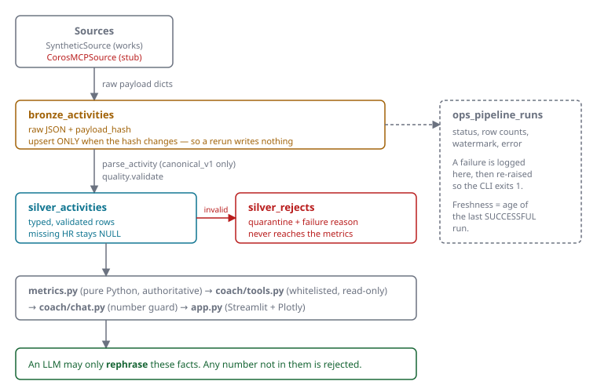
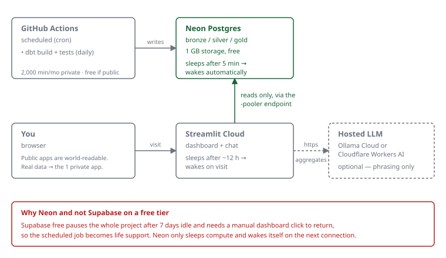

# COROS Running Coach

A running-data platform with a "chat with your data" coach. Ingestion is Python,
storage is SQLite locally and Postgres in production, and the dashboard is
Streamlit + Plotly.

**The demo data is SYNTHETIC.** It is generated by `SyntheticSource` and is not
real activity data. The dashboard labels it prominently whenever it is present.

---

## Status in one line

Stages 1-2 (ingestion, coach, dashboard) are built and tested, and the Stage 3
gold layer is written with SQL-vs-Python parity proven:
**110 tests pass**, ruff is clean, bandit reports no medium/high issues, and
pip-audit reports no known vulnerabilities. The COROS MCP adapter is **not
implemented** — it is a stub that fails loudly. See
[Verification status](#verification-status) for the per-feature breakdown.

---

## Architecture

<figure>

<figcaption>Bad rows are quarantined with a reason instead of being dropped or coerced, and nothing invalid reaches the metrics.</figcaption>
</figure>


**Storage.** One `Store` class serves both backends. SQLite's `?` placeholder
dialect is canonical and is rewritten to `%s` for Postgres at the boundary, so
the upsert statements in `store.py` are written once and shared.

**Why Python rather than dbt.** The bronze→silver layer rejects unknown
schemas, quarantines bad rows *with a reason*, and hashes payloads to decide
whether to write at all — imperative concerns a `SELECT` models poorly.

A dbt gold layer was built and then **removed**: nothing consumed it. The
dashboard reads `silver_activities` through the fact tools, which aggregate in
Python, and at this data volume (a few thousand rows even after years of
running) there is nothing expensive to precompute. Keeping it would have meant
maintaining two implementations of every metric. See
`git log --diff-filter=D -- dbt/` to recover it if a second consumer ever
appears — a BI tool, a notebook, or year-over-year models that SQL handles
better than Python.

### Deploying on free tiers

The whole stack runs at **$0** with no code changes — only `.env` values.

| Layer | Free option | Constraint that actually bites |
|---|---|---|
| Database | **Neon** | 1 GB; compute sleeps after 5 min, **wakes itself** |
| Dashboard | Streamlit Community Cloud | Sleeps after ~12 h; wakes on visit |
| Ingestion | GitHub Actions | 2,000 min/month private; unlimited if public |
| LLM (optional) | Ollama Cloud or Cloudflare Workers AI | Unpublished free allowance |

**Prefer Neon over Supabase here.** Supabase's free tier pauses the entire
project after 7 days of inactivity and needs a **manual dashboard click** to
return, which makes the scheduled ingest load-bearing: miss it and the dashboard
stays down until you intervene. Neon only suspends compute and resumes on the
next connection, so the failure mode is a slow first query rather than an
outage. Supabase remains a fine choice if you later want its bundled auth,
storage or realtime — none of which this project uses.

Four things to get right:

1. **Use the pooled endpoint** — Neon's `-pooler` hostname (or Supabase's port
   6543). Streamlit reruns the script on every interaction and would otherwise
   churn direct connections.
2. **Ingestion must live in GitHub Actions.** Streamlit Cloud cannot run
   background work, and sleeps.
3. **Watch Actions minutes** on a private repo. A public repo gets unlimited
   minutes, and is safe here: everything committed is synthetic, with
   `.gitignore` plus a CI guard keeping real data out.

**No free tier includes backups.** The design is the safety net instead: bronze
retains raw payloads, `rebuild_silver()` reprocesses from it, and ingestion is
idempotent. Add a periodic `pg_dump` if you hold real data.

<figure>

<figcaption>Every component is free tier. Neon sleeps and wakes itself; Supabase would pause after 7 days and need a manual unpause.</figcaption>
</figure>


Public Streamlit apps are world-readable; use the single free private app for
real data, or keep the public deployment on synthetic data.

### Layout

| Path | Purpose |
|---|---|
| `src/corach/store.py` | SQLite/Postgres layer, shared upsert SQL |
| `src/corach/transform.py` | `canonical_v1` parser; rejects unknown schemas |
| `src/corach/quality.py` | Row validation and pipeline freshness |
| `src/corach/metrics.py` | Pure-Python metrics; no DB, no third-party deps |
| `src/corach/ingest.py` | Incremental ingestion, retries, `rebuild_silver()` |
| `src/corach/sources/` | `Source` protocol, synthetic source, COROS MCP stub |
| `src/corach/coach/tools.py` | Whitelisted read-only fact tools |
| `src/corach/coach/chat.py` | Router, deterministic answers, number guard |
| `src/corach/coach/llm.py` | Stdlib OpenAI-compatible client |
| `app.py` | Streamlit dashboard |

---

## Quickstart

```bash
python -m venv .venv && .venv/Scripts/activate      # Windows
pip install -r requirements-dev.txt

export PYTHONPATH=src                                # Windows: $env:PYTHONPATH="src"
python -m corach.ingest --source synthetic           # load SYNTHETIC demo data
pytest -q
streamlit run app.py
```

### CLI

```bash
python -m corach.ingest --source synthetic     # incremental (watermark + overlap)
python -m corach.ingest --full-refresh         # ignore the watermark
python -m corach.ingest --rebuild-silver       # reprocess silver from bronze
```

Exit code is non-zero when a run fails, and the failure is recorded in
`ops_pipeline_runs` before being re-raised.

### Configuration

Copy `.env.example` to `.env`. Leave `DATABASE_URL` unset to use SQLite.

| Variable | Meaning |
|---|---|
| `DATABASE_URL` | Postgres DSN. Unset → SQLite |
| `CORACH_SQLITE_PATH` | SQLite file (default `data/corach.db`) |
| `CORACH_SOURCE` | `synthetic` or `coros_mcp` |
| `CORACH_OVERLAP_DAYS` | Watermark overlap window (default 3) |
| `LLM_BASE_URL` / `LLM_MODEL` / `LLM_API_KEY` | Optional LLM phrasing |

---

## Metric definitions

These are deliberate choices. The obvious alternative is wrong in each case.

**Pace** = *total duration ÷ total distance* over the period. It is **not** the
mean of per-run paces, which would over-weight short runs. For a 1 km jog at
6:00/km plus a 9 km run at 5:00/km: the correct aggregate is 3060 s over 10 km =
**5:06/km**, whereas averaging the two pace values gives **5:30/km**.

**Average heart rate** is **duration-weighted** across only those runs that
report HR. Runs without HR are excluded from both numerator and denominator —
they are never counted as zero. For a 60-minute run at 150 bpm plus a 30-minute
run with no HR, the answer is 150 bpm, not the 100 bpm that zero-filling gives.

**Missing values stay NULL.** A missing distance, duration or HR is `None`
everywhere — in the database, in the metrics, and in the UI, where it renders as
`—`. A reported `0` is a different thing: the parser preserves it and the
validator rejects it as implausible.

**Weeks** are ISO weeks starting Monday, bucketed by UTC date.

**Zero-run weeks** appear in the series with `0 km`, `pace = None` and
`avg_hr = None`.

**Week-over-week** is `None` when there is no prior week, or when the prior week
had 0 km — a percentage change against zero is undefined, not infinite.

**Rolling windows** (7/28/90 days) are inclusive of today and carry
`sufficient=False` when the available history is shorter than the window, so a
28-day figure built from 3 days of data is never presented as complete.

**Freshness** is the age of the last *successful* pipeline run. An unknown or
unparseable timestamp is never reported as fresh.

---

## How the coach avoids making numbers up

1. A keyword router maps the question to one of six **whitelisted** tools.
   Integer arguments are range-checked; `days` must be one of 7/28/90.
2. The tool queries the database and returns **verified facts** as JSON. The LLM
   never writes SQL and never computes a statistic.
3. A **deterministic, rule-based answer is always produced first.**
4. If an LLM is configured, it may only rephrase those facts. Its output then
   passes a **number guard**: every numeric token in the reply must appear in the
   facts. Any unverified number — including a heart rate invented for a run that
   reported none — causes the LLM answer to be discarded in favour of the
   deterministic one.
5. With no LLM configured, or when the call fails, step 3's answer is used.

The dashboard shows which path produced the answer and an expander with the exact
facts used.

### LLM provider privacy

Only aggregates are sent — never raw activity rows. Verified against primary
sources on 2026-10-17:

| Provider | Trains on inputs? | Retention | Source |
|---|---|---|---|
| **Cloudflare Workers AI** (recommended) | **No** — "Cloudflare does not use Customer Content processed by Workers AI to train AI models" | Not retained after the request for standard inference | [docs](https://developers.cloudflare.com/workers-ai/platform/privacy/) |
| **Ollama Cloud** | **No** — "We do not use your inputs or outputs to train any AI models" | "Processed transiently… not stored beyond the time required to fulfill the request" | [policy](https://registry.ollama.ai/privacy) |
| **Groq** | **Not stated on the data page** — it documents retention only, not training | "By default, Groq does not retain customer data for inference requests"; abuse/reliability logs up to 30 days; ZDR available | [docs](https://console.groq.com/docs/your-data) |
| **Google Gemini free tier** | **Yes** — content is used "to provide, improve, and develop" Google products; human reviewers may read inputs and outputs | — | [terms](https://ai.google.dev/gemini-api/terms) |

**Recommendation: Cloudflare Workers AI**, which carries the clearest explicit
no-training commitment in its own documentation.

**Correction to a common claim:** Groq's data page does **not** say it refrains
from training on inputs — it covers retention only. The no-training commitment
appears in its contractual terms, not that page, so treat "Groq doesn't train on
free-tier inputs" as unverified by the primary source cited above.

**Avoid the Gemini free tier for personal data.** Note that activating Cloud
Billing moves Gemini API usage to paid-tier data handling, but Google AI Studio
is treated as free-tier regardless.

---

## Verification status

Honest accounting. "Tested" means an automated test exercises it and I ran it.

### Tested

| Feature | Evidence |
|---|---|
| Idempotent rerun (0 bronze writes) | `test_rerun_is_idempotent`, plus CLI: 2nd run `bronze_changed=0` |
| Incremental fetch via watermark + overlap | `test_incremental_fetch_uses_watermark_with_overlap` |
| Changed payload updates bronze and silver | `test_changed_payload_updates_bronze_and_silver` |
| Unchanged payload leaves bronze untouched | `test_unchanged_payload_leaves_bronze_hash_untouched` |
| Exponential backoff, transient errors only | `test_retry_succeeds_after_transient_errors` (delays `[1.0, 2.0]`) |
| Permanent errors never retried | `test_permanent_error_is_not_retried` |
| Failed run logged then re-raised; CLI exits 1 | `test_failed_run_is_logged_and_reraised` |
| Quarantine with reasons | `test_bad_rows_are_quarantined_with_reasons` |
| NULL HR survives round-trip | `test_null_hr_survives_the_round_trip` |
| `rebuild_silver()` from bronze | `test_rebuild_silver_reprocesses_from_bronze` |
| COROS MCP stub fails loudly | `test_coros_mcp_stub_fails_loudly`; CLI exits 1 |
| Unknown schema rejected | `test_unknown_schema_is_rejected` |
| Metric edge cases | `tests/test_metrics.py` (zero-run weeks, WoW vs empty week, insufficient history) |
| Tool argument bounds | `tests/test_coach.py::BoundedIntTest` |
| Number guard rejects hallucinated figures | `test_rejects_hallucinated_number`, `test_rejects_invented_heart_rate_when_hr_is_null` |
| LLM failure falls back to deterministic | `test_llm_failure_falls_back_to_deterministic` |
| https required except localhost | `test_https_is_required_for_remote_hosts` |
| API key never leaks in errors | `test_api_key_never_leaks_in_errors` |
| `urlopen` refuses non-http schemes | `test_default_transport_refuses_non_http_schemes` |
| Store usable across threads | `test_store_is_usable_from_another_thread` |
| Dashboard renders, empty-DB path, chat box | `tests/test_app_smoke.py` (Streamlit `AppTest`) |
| CI private-data guard | Run locally both ways: passed clean, and caught a planted `.env` + `data/*.db` |
| Gold SQL matches `metrics.py` | `tests/test_gold_parity.py` — 8 tests executing the metric SQL and comparing to the Python |

### Written, not fully verified

| Item | Why |
|---|---|
| **Postgres backend** | All local tests run on SQLite. The Postgres path (`psycopg`, `jsonb`, `%s` placeholders) is **written but never executed here** — no Postgres instance was available locally. The `postgres` CI job runs `corach.verify_postgres` against a real server, but that job has not yet run. Verify against your actual provider before production use. |
| **GitHub Actions CI** | Every step was run locally and passes (ruff, pytest, bandit, pip-audit, data guard, ingest smoke test). The workflow has **not run on GitHub** — no remote is configured. |
| **LLM against a real provider** | Tested only with a fake transport. No real API call was made to any provider. |

### Not implemented

| Item | Notes |
|---|---|
| **COROS MCP adapter** | Stub that raises `PermanentSourceError`. No COROS MCP server was configured, so its tools, auth flow, field names and units are **UNVERIFIED**. `sources/coros_mcp.py` lists what must be captured first. Guessing field names would fabricate data. |
| FIT/CSV file-parser fallback | Planned if MCP cannot run unattended |
| Gold layer beyond the three models | Further models (e.g. per-run training stress) not yet designed |
| Scheduled ingestion workflow, CD | Stage 3 |
| Fuller AI coach (7/28/90-day rationale) | Stage 3 |

---

## Testing

```bash
pytest -q                     # 110 tests
ruff check .
bandit -r src -ll
pip-audit --strict --requirement requirements.txt

# Postgres-only checks (needs DATABASE_URL pointing at a real server):
PYTHONPATH=src python -m corach.verify_postgres
```

No test touches the network: the LLM client is driven through an injected fake
transport.

---

## Privacy

`.gitignore` excludes `data/`, `*.db`, `*.fit`, `*.tcx`, `*.gpx` and `.env`, and
CI fails if any of them are ever tracked. Only aggregate figures are sent to an
LLM provider, and the API key is redacted from every error path.
